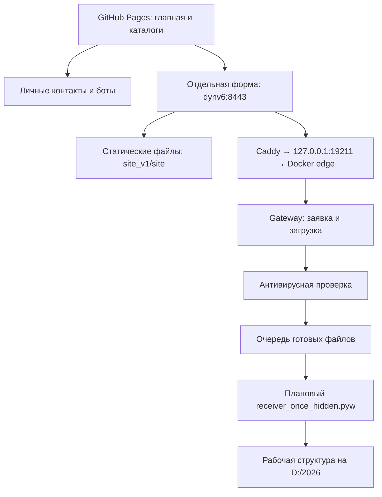

# FotoMag — сайт и приём заказов

Требования и проверенная исходная архитектура. Дата фиксации: **28 ноября 2026 года**, часовой пояс **Europe/Samara (UTC+04:00)**. Владелец проекта — Александр Григорьевич, фотоцентр FotoMag, Ижевск.

Этот документ хранит цель, требования и границы компонентов. Факт выпуска, результаты контрольных заказов и незавершённые пункты находятся в [ACCEPTANCE.md](ACCEPTANCE.md). Не считать описание желаемого поведения свидетельством его проверки.

## Цель и приоритеты

Клиент открывает сайт на телефоне, выбирает услугу или конкретный товар, видит достоверные сведения и передаёт заявку выбранным способом. При прямой загрузке файлы должны доходить до рабочего компьютера и сохраняться в согласованной структуре на `D:\2026`.

| Приоритет | Клиентский риск | Что требуется доказать |
| --- | --- | --- |
| P0 | Потерянная заявка, неверный адрес, невозможная отправка, ложный успех | Сохранённые параметры заявки; правильный адрес; подтверждение от соответствующего этапа системы |
| P1 | Неверный товар/цвет/SKU, цена, неудобная мобильная форма, запутанный Wi-Fi | Совпадение карточки и заявки; работа выбора и возврата; честный поддерживаемый сценарий |
| P2 | Скорость, визуальные дефекты, отсутствие инструкций и контроля | Проверяемые бюджеты, адаптивность, порядок восстановления и работающий мониторинг |

## Репозиторий и рабочие среды

| Сущность | Подтверждённые сведения |
| --- | --- |
| Репозиторий | `https://github.com/screamble123h/fotomag-print-hub` |
| Публичный сайт | `https://screamble123h.github.io/fotomag-print-hub/` |
| Основная ветка | `main`; выпуск через PR с обязательным `Validate site security` |
| Исходный проверенный коммит | `3462ed62054f753d486ef58fbba311da3ab2bc07` |
| Рабочая ветка исправлений | `work/fotomag-reliability-20261128` |
| Windows-компьютер | `DESKTOP-P6L7HTI` |
| Windows worktree Codex | `D:\FotoMag_Site_Orders`, ветка `work/fotomag-reliability-20261128`; перед подготовкой LAN-выпуска подтверждён HEAD `e922d67bff2b17fc03d8208281efb5026c3e19ca` |
| Инструменты на Windows | Codex CLI `0.153.4`, Git `2.55.0.windows.3`, Node.js `24.19.0`; Codex авторизован через ChatGPT |
| Контрольное задание | `FM-SITE-20261128-001`: завершение с exit 0, 28.11.2026 16:01:48 Europe/Samara |
| Контрольные журналы | `D:\FotoMag_Site_Orders_Control\FM-SITE-20261128-001`; содержимое журналов не публиковать в репозитории |
| Проверенный HEAD исправлений | `2fe980ed012a0ae2e9c689be7fdfe0753bb6d41b`; обязательный `Validate site security` прошёл вместе со всеми тремя браузерными наборами |
| Объединение исправлений | [PR №32](https://github.com/screamble123h/fotomag-print-hub/pull/32), merge SHA `e922d67bff2b17fc03d8208281efb5026c3e19ca` |
| Связанный CI | [Run 46144732168 / job 140978153753](https://github.com/screamble123h/fotomag-print-hub/actions/runs/46144732168/job/140978153753), **PASS** |

**Текущая граница выпуска:** код объединён после успешного CI, опубликованная версия подтверждена точным совпадением семи изменённых ресурсов с merge-коммитом и контрольными переходами по публичному интерфейсу. LAN-комплект переключён и проверен по HTTPS, изменение раскладки receiver применено после восьми автономных проверок. Три нейтральных файла доставлены через HTTPS API с рабочего ПК; размеры и SHA-256 совпали, повторы и один прерванный PUT завершились в той же заявке. Публичный интерфейс и API проверены отдельно: сквозная отправка с физического телефона и из внешней сети не подтверждена. Подробные доказательства находятся в [ACCEPTANCE.md](ACCEPTANCE.md).

Рабочая папка CLI, ветка Git, сеанс Codex и проект в графическом интерфейсе — разные сущности. Подтверждённый контроль CLI не доказывает создание проекта в интерфейсе или непрерывную автономную работу после чата.

Существующие незакоммиченные пользовательские изменения в старых копиях сохраняются. Названия `FotoMag_MUGS_RELEASE_20261127`, `FotoMag_Direct_Upload_Channel`, `FotoMag_Direct_Launch_20261125`, `FotoMag_LAN_SITE_20261126`, `FotoMag_LocalPortal_20261126`, `FotoMag_Codex_TZ21` и `FotoMag_Remote_Agent` сами по себе не определяют производственный источник.

## Реальная граница публичной и локальной части

GitHub Pages обслуживает статическую клиентскую часть. Публичная конфигурация репозитория сохраняет пустой `fotomag-upload-api` и CSP `connect-src 'none'`: эта конфигурация не обращается к серверному API загрузки напрямую. Переход к локальной форме является отдельным сценарием, с разрешёнными параметрами типа услуги и формата.

Проверенная конфигурация локального входа:

- `https://fotomag-izhevsk.dynv6.net:8443/`: Caddy привязан к `192.168.1.114`; API направляется через `127.0.0.1:19211` в Docker edge, затем в gateway и антивирусную проверку.
- Активная статическая папка этого входа после переключения **16:34:19 Europe/Samara**: `D:\FotoMag_MVP_20261125\site_v1\site\releases\e922d67bff2b17fc03d8208281efb5026c3e19ca`. Полный комплект содержит **161 статический файл**. В **16:34:24** проверены 17 HTTPS-ресурсов общим размером 272 041 байт: размеры и SHA-256 совпали с подготовленным манифестом; health HTTP 200, `accepting_uploads=true`.
- Постоянная конфигурация подтверждена: смонтированный `/etc/caddy/Caddyfile` и подготовленный кандидат совпали по SHA-256 `3a1ef14747bd3459eed31f07680e05df4800de430b21220859bf25c6569f9f1f`.
- Получатель: плановая одноразовая задача со скриптом `D:\FotoMag_Direct_Launch_20261125\receiver_once_hidden.pyw`, запускаемая примерно каждую минуту. Статус — `D:\FotoMag_Direct_Launch_20261125\receiver_last_status.json`; успешный контракт wrapper: `exit=0` и `result=empty` либо `saved` с целым `count`. В контрольной проверке **16:19 Europe/Samara** receiver был исправен, возраст статуса **53 секунды**. Пустая очередь не является проверкой доставки файла.
- Отдельная LAN-страница на порту 443 использует `D:\FotoMag_LAN_SITE_20261126`. Её нельзя считать тем же выпуском или тем же путём получения без отдельной проверки.
- Службы в `C:\ProgramData` — отдельный производственный контур. Наблюдение их состояния не разрешает произвольную правку или перезапуск.

Схема описывает установленную связь компонентов; внутри статического mount используется версионная папка выпуска. Публичные ресурсы и LAN-комплект сверены независимо. Получение контрольного заказа через API с рабочего ПК подтверждено отдельно по статусу и файлам на диске. Доступность из внешней сети не подтверждена; ошибка сетевого прокси инструмента не доказывает неисправность сервиса.

DNS-проверка через `1.1.1.1` вернула для `fotomag-izhevsk.dynv6.net` частный IPv4 **192.168.1.114**. Это LAN-назначение проверенного адреса; такая A-запись не предоставляет обычный внешний IPv4-вход. Облачный пробный запрос был остановлен ответом HTTP 403 от прокси среды. Этот результат не является диагностикой отказа приёмщика. Контрольная загрузка из внешней сети ещё не подтверждена.

## Главная страница и фирменное оформление

- Единая точка входа с сохранением `souvenirs.html` и `mugs.html`.
- Фирменные цвета: чёрный, белый, жёлтый; точные параметры — из утверждённых материалов.
- Оригинал логотипа: `D:\FOTOMAG_BRAND_SYSTEM\01_LOGO\ORIGINALS_PROTECTED\FotoMag_MASTER_ORIGINAL.svg`; репозиторный файл `assets/fotomag_logo_official.svg` сверяется с ним. Сохранить пропорции, свободное пространство и читаемость.
- Основной заголовок: «Чем можем помочь?». Фраза шапки: «FotoMag — больше, чем фото».
- Боты в верхней части; понятный личный контакт; кнопки «Позвонить» и «Подключиться к Wi-Fi бесплатно».
- Адрес: Ижевск, ул. Пушкинская, 173. Режим: Пн–Пт 08:30–21:00; Сб–Вс 10:00–19:00.
- Аккуратные плитки, понятные пиктограммы, умеренные тени. VK, MAX, Telegram и Яндекс.Почта имеют узнаваемые цвета.
- При 360, 390, 430, 768 и 1366 px нет наложений и горизонтального переполнения. Плавающие панели не закрывают действия; клавиатура, увеличенный текст и «Назад» сохраняют работоспособность.

## Каталог и розничные цены

Путь: **категория → полное название модели/серии → цвет и артикул → крупный просмотр → заявка**.

Источник данных кружек — `assets/mug-catalog.json`: подтверждены **139 записей, 31 серия, 138 изображений**. У классической белой кружки пока нет подтверждённой фотографии; изображение похожего товара не подставлять.

| Позиция | Подтверждённая розничная цена |
| --- | --- |
| Классическая белая кружка FotoMag | 650 ₽ |
| Молочник 450 мл, артикул 10335 | 1250 ₽ |
| Остальные модели | «Цену уточним» до подтверждения розничного прайса FotoMag |

Карточка и текст заявки формируются из одного источника. Оптовые цены поставщика не становятся розничными автоматически. Количество — целое число в допустимом диапазоне. Неизвестный артикул не подменяется другим товаром.

В каталоге восемь карточек на порцию, адаптивная сетка, квадратная область изображения с сохранением пропорций. Крупный просмотр имеет «Назад», «Вперёд» и закрытие; возврат сохраняет место, выбор и доступный фокус. Ссылка `mugs.html?sku=...` открывает конкретный товар. Комментарий и личные данные не включаются в публичную ссылку.

### Почему направлений 28, а не 27

В `souvenirs.html` 28 уникальных направлений (`name="gift"`), без точных дублей. При раздельном учёте согласованных видов кружек, подушек/наволочек и обычных/акриловых магнитов перечень также даёт 28. Ранее встречавшееся число 27 не является основанием удалить одну позицию.

| Группа | Число | Направления |
| --- | ---: | --- |
| Одежда и текстиль | 6 | Футболки; толстовки и худи; кепки и бейсболки; шопперы; декоративные подушки; наволочки |
| Кружки и посуда | 7 | Классические; хамелеоны; конусные; молочники; термокружки; тарелки; подставки под кружки |
| Небольшие подарки | 7 | Магниты; акриловые фотомагниты; брелоки; значки; зеркальца; пазлы; фотокристаллы |
| Фото и декор | 8 | Рамки; фотокниги; календари; холсты; плакаты и постеры; коврики для мыши; чехлы; открытки и фотокарточки |

Это направления запроса, а не обещание наличия каждого изделия. В текущих 139 записях кружек нет подтверждённых моделей термокружек: переход показывает отсутствие моделей и контакт для уточнения, а не чужую категорию.

Подготовка фото из присланного снимка за 450 ₽ сохраняется как отдельная услуга. Она не подменяет новую фотосъёмку в магазине. Цены и комплектность иных форматов не расширять предположениями.

## Каналы и содержание заявки

Разделяются три пути: **личное обращение**, **бот**, **прямая загрузка**. Источник утверждённых публичных контактов — текущие HTML/JS и проверки назначений. Сохраняются телефон `+7 912 466-50-90`, почта `kodakprint@yandex.ru`, отдельные ссылки личных VK/Telegram/MAX и ботов. Полная ссылка личного MAX используется без сокращений.

Для товара сохраняются полное название и серия, цвет, артикул, количество, подтверждённая цена либо уточнение, ссылка на товар и комментарий. Для фото/документов сохраняются тип услуги и выбранный формат при переходе между страницами.

Поддержку заполнения необходимо проверять для каждого канала. Если ссылка не передаёт текст, показывается подготовленный текст и удобное копирование с ручным резервным вариантом. Фотографию клиент прикрепляет в приложении отдельно. Открытие приложения или письма не является отправкой или приёмом заявки.

В опубликованной версии контрольные переходы **главная → Wi-Fi → формат 4×6 → личное обращение** сохранили полный текст и правильный mail URL. Переход **сувениры (28 направлений) → белый молочник 450 мл, SKU 10335, 1250 ₽ → заявка** сохранил полное название, серию, артикул, цвет, количество и каноническую ссылку. В этом сеансе ошибок JavaScript источника сайта не обнаружено; реальная отправка через мессенджер/почту не выполнялась.

## Прямая загрузка и состояния

Проверять весь путь: опубликованная страница → форма → приёмщик → запись заявки → доставка → конечная папка. DNS, TLS, порт, CORS и CSP оцениваются в контексте реальной конфигурации, отдельно внутри AGFA и снаружи.

Форма показывает файлы, допустимые форматы/размеры, прогресс, отмену, повтор и понятную ошибку. Текущие клиентские ограничения: до десяти файлов, до 25 МиБ каждый, до 100 МиБ суммарно; фактические серверные ограничения должны быть согласованы с формой.

| Состояние | Необходимое основание |
| --- | --- |
| Загрузка выполняется | Начатая передача и фактический прогресс |
| Сервер принял заявку | `/submit` с `received=true` и ожидаемым receipt либо `/status` с тем же receipt и `status=pending`; очередь backend получает `pending` после проверенного submit |
| Доставлено на компьютер | Ожидаемый receipt, одновременно `status=received` и `downloaded_to_pc=true`; для приёмки дополнительно сверяются файлы и SHA-256 на D: |
| Нужно действие клиента | Конкретная ошибка, недоступность, отмена либо неподтверждённый этап |

Повторное нажатие, обрыв сети, закрытие/повторное открытие экрана и повтор после тайм-аута не должны порождать неконтролируемые дубли или ложный успех. Отмена передачи не должна обещать отмену уже принятой сервером заявки.

Раскладка receiver обновлена **16:34:24 Europe/Samara** после восьми автономных проверок, прошедших в среде разработки и на Windows. Для новых заявок исходные файлы сохраняются в «Исходники», рядом создаётся пустая папка «Обработанные JPEG», метаданные остаются в корне. Существующие файлы прошлых заказов не переносились. Применённый исходник: `D:\FotoMag_Direct_Launch_20261125\receiver\upload_gateway\workstation_agent.py`; резервная копия и SHA-256 записаны в приёмке.

Реальное получение после этой правки подтверждено для нейтральной заявки **`FM-W-20261128-B8CEA4C`**, order ID `b8cea4cc4e0f41e88330e25b90ca1ee6`. Начальный статус `pending` подтверждал только приём сервером; в **16:40 Europe/Samara** получены `status=received` и `downloaded_to_pc=true`. В `D:\2026\11\28\Напрямую\FM_TEST_20261128\FM-W-20261128-B8CEA4C` находятся три файла в «Исходники», папка «Обработанные JPEG» существует и пуста. Для каждого файла найдена одна копия; размеры и SHA-256 совпали с исходниками. Метаданные подтвердили `documents`, тестовое имя клиента, пустой телефон и комментарий `TECHNICAL TEST DO NOT PRINT`.

Контрольный комплект из `D:\FotoMag_Site_Orders_Control\FM-SITE-20261128-003` включал нейтральный JPEG, PDF с кириллическим именем и JPEG **26 213 376 байт** (**25 МиБ − 1024 байта**). Реальный ручной сценарий повторов create/PUT/submit завершился **PASS** с тем же order ID. Первый PUT прерван после **7203 из 14406 байт**, затем полностью повторён в том же файловом слоте; сетевые адаптеры не отключались. Имена с префиксами `01_`, `02_`, `03_`, размеры и хеши записаны в [ACCEPTANCE.md](ACCEPTANCE.md), точный JSON проверки — в `D:\FotoMag_Site_Orders_Control\FM-SITE-20261128-003\delivery-verification.json`. Это проверка HTTPS API с рабочего ПК; она не запускала физическую печать или сообщения и не входит в ежечасный мониторинг.

## Wi-Fi

Сохранить QR-код, сеть AGFA, утверждённый гостевой пароль и отдельную кнопку «Подключиться». Реквизиты и тип защиты сверяются с фактической сетью. На том же телефоне должен быть доступен сценарий без сканирования собственного экрана: копирование реквизитов и понятные действия в настройках Wi-Fi.

Из матрицы `assets/wifi-agfa.svg` фактически декодировано **`WIFI:T:WPA;S:AGFA;P:00001111;;`**. Обратное кодирование восстановленной строки полностью совпало с SVG-матрицей. Это подтверждает данные QR; фактическая защита точки доступа и подключение телефонов остаются непроверенными. `Get-NetConnectionProfile` на ПК показал профиль AGFA с Ethernet и доступом Internet, поэтому результат ПК не переносится на беспроводное подключение Android/iPhone.

При отказе облачного браузера в доступе к буферу обмена опубликованный интерфейс показал AGFA и пароль для ручного ввода, без ложного сообщения о копировании. В CI с разрешённым буфером обмена проверено копирование **00001111**.

Не использовать APK, установочные профили и сторонние установочные страницы. Различать открытие QR, копирование пароля, системное подтверждение, подключение к сети и наличие интернета. Проверка фиксируется по реальным устройствам: ОС, браузер, поведение кнопки/QR, подтверждения и доступ в интернет. Без устройства результат остаётся неподтверждённым.

## Оркестратор и постоянный контроль

В проверенном контуре `D:\FotoMag_Orchestrator` документация относится к планированию/чтению; работающий исполняемый диспетчер для этого сайта не подтверждён, запись сайта в проверенном реестре отсутствует. Guard-файлы не изменялись. Успешное контрольное задание Codex выполнено через доступный маршрут CLI; это отдельный факт.

Для каждого задания нужны ID, цель, папка, ветка, входы, критерии, фактический статус и результат. Ведущий исполнитель хранит состояние; Codex готовит ограниченные изменения; Commander проверяет локальные компоненты; независимая проверка оценивает клиентские сценарии.

### Настроенный мониторинг

Создана и включена ChatGPT Automation **«FotoMag — контроль сайта и приёмщика»**, ID **`Automation_2fd0d486c9688191a59cd1b206cf88b4`**. Расписание — `RRULE:FREQ=HOURLY`, начало **28.11.2026 16:45 Europe/Samara**, далее каждый час в `:45`. Исполнитель вызывает через Commander одну команду `D:\FotoMag_Site_Orders\scripts\monitor_site.py` на `DESKTOP-P6L7HTI`.

Команда проверяет три публичные страницы, LAN `/api/health` и свежесть/результат `receiver_last_status.json`. Контрольный запуск в **16:19** вернул **пять healthy, exit 0**. Повтор в **16:20** подтвердил дедупликацию по часовому ключу. После всех выпусков и доставки в **16:41:48** повторный контроль вернул **пять healthy, exit 0**: публичные index/souvenirs/mugs — **43 704 / 11 620 / 2 987 байт**, LAN health HTTP 200, `accepting_uploads=true`, возраст успешного статуса receiver **40 секунд**. Журналы: `D:\FotoMag_Site_Orders_Control\monitor\latest.json` и ежедневный JSONL. Первый самостоятельный плановый запуск, назначенный на **16:45**, завершился **16:50:06**, run `2946c253-ecbc-832a-b12e-26f9f34ee2ea`: команда на ПК выполнена, PID **49760**, **exit 0**, `skipped` по часовому ключу. Исполнение расписания подтверждено; новой сетевой проверки в этом запуске не было. Ручной `run_now` зафиксирован в приёмке отдельно.

Перед настройкой просмотрено 25 действующих задач; дублирующая выделенная проверка сайта не найдена. Существующий `FotoMag-Monitor` не изменён, новая задача Windows Scheduler не добавлена. Чтобы остановить этот контроль, отключить именно Automation `Automation_2fd0d486c9688191a59cd1b206cf88b4`.

Регулярный контроль не создаёт заказы, не отправляет почту/сообщения и не выполняет автоматических исправлений. Проверки исходников запускаются при изменениях через CI. Постоянное автономное выполнение доработок сайта старым оркестратором не подтверждено.

Открытые этапы: внешний сетевой тест, фактическая защита точки доступа и проверки на физических Android/iPhone. Публичные контрольные переходы, реальная доставка нейтральных файлов через API с ПК со сверкой SHA-256 и первый самостоятельный запуск расписания завершены. Дальнейшую исправность подтверждают только новые записи мониторинга. Актуальные доказательства и границы каждого этапа ведутся в [ACCEPTANCE.md](ACCEPTANCE.md).
