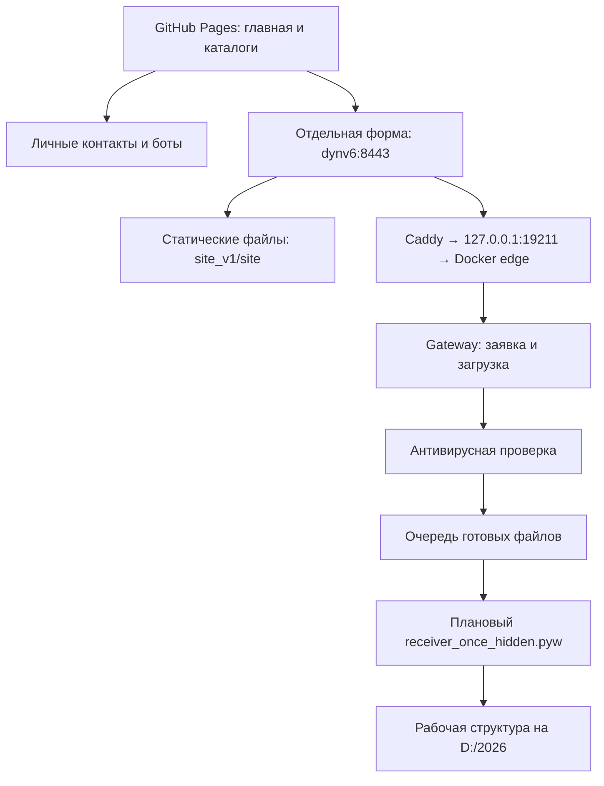

# FotoMag — сайт и приём заказов

Требования и проверенная исходная архитектура. Дата фиксации: **28 ноября 2026 года**, часовой пояс **Europe/Samara (UTC+04:00)**. Владелец проекта — Александр Григорьевич, фотоцентр FotoMag, Ижевск.

Этот документ хранит цель, требования и границы компонентов. Факт выпуска, результаты контрольных заказов и незавершённые пункты находятся в [ACCEPTANCE.md](ACCEPTANCE.md). Не считать описание желаемого поведения свидетельством его проверки.

## Цель и приоритеты

Клиент открывает сайт на телефоне, выбирает услугу или конкретный товар, видит достоверные сведения и передаёт заявку выбранным способом. При прямой загрузке файлы должны доходить до рабочего компьютера и сохраняться в согласованной структуре на `D:\2026`.

| Приоритет | Клиентский риск | Что требуется доказать |
| --- | --- | --- |
| P0 | Потерянная заявка, неверный адрес, невозможная отправка, ложный успех | Сохранённые параметры заявки; правильный адрес; подтверждение от соответствующего этапа системы |
| P1 | Неверный товар/цвет/SKU, цена, неудобная мобильная форма, запутанный Wi-Fi | Совпадение карточки и заявки; работа выбора и возврата; честный поддерживаемый сценарий |
| P2 | Скорость, визуальные дефекты, отсутствие инструкций и контроля | Проверяемые бюджеты, адаптивность, порядок восстановления и работающий мониторинг |

## Репозиторий и рабочие среды

| Сущность | Подтверждённые сведения |
| --- | --- |
| Репозиторий | `https://github.com/screamble123h/fotomag-print-hub` |
| Публичный сайт | `https://screamble123h.github.io/fotomag-print-hub/` |
| Основная ветка | `main`; выпуск через PR с обязательным `Validate site security` |
| Исходный проверенный коммит | `3462ed62054f753d486ef58fbba311da3ab2bc07` |
| Рабочая ветка исправлений | `work/fotomag-reliability-20261128` |
| Windows-компьютер | `DESKTOP-P6L7HTI` |
| Windows worktree Codex | `D:\FotoMag_Site_Orders`, ветка `work/fotomag-codex-control-20261128` от исходного коммита |
| Инструменты на Windows | Codex CLI `0.153.4`, Git `2.55.0.windows.3`, Node.js `24.19.0`; Codex авторизован через ChatGPT |
| Контрольное задание | `FM-SITE-20261128-001`: завершение с exit 0, 28.11.2026 16:01:48 Europe/Samara |
| Контрольные журналы | `D:\FotoMag_Site_Orders_Control\FM-SITE-20261128-001`; содержимое журналов не публиковать в репозитории |

Рабочая папка CLI, ветка Git, сеанс Codex и проект в графическом интерфейсе — разные сущности. Подтверждённый контроль CLI не доказывает создание проекта в интерфейсе или непрерывную автономную работу после чата.

Существующие незакоммиченные пользовательские изменения в старых копиях сохраняются. Названия `FotoMag_MUGS_RELEASE_20261127`, `FotoMag_Direct_Upload_Channel`, `FotoMag_Direct_Launch_20261125`, `FotoMag_LAN_SITE_20261126`, `FotoMag_LocalPortal_20261126`, `FotoMag_Codex_TZ21` и `FotoMag_Remote_Agent` сами по себе не определяют производственный источник.

## Реальная граница публичной и локальной части

GitHub Pages обслуживает статическую клиентскую часть. На исходном публичном сайте `fotomag-upload-api` пустой, а CSP содержит `connect-src 'none'`: опубликованная страница не обращается к серверному API загрузки напрямую. Переход к локальной форме является отдельным сценарием.

Проверенная конфигурация локального входа:

- `https://fotomag-izhevsk.dynv6.net:8443/`: Caddy привязан к `192.168.1.114`; API направляется через `127.0.0.1:19211` в Docker edge, затем в gateway и антивирусную проверку.
- Подключённая статическая папка этого входа: `D:\FotoMag_MVP_20261125\site_v1\site`.
- Получатель: плановая одноразовая задача со скриптом `D:\FotoMag_Direct_Launch_20261125\receiver_once_hidden.pyw`. Проверенный запуск 28.11.2026 около 16:02 сообщил `empty`, exit 0. Пустая очередь не является проверкой доставки файла.
- Отдельная LAN-страница на порту 443 использует `D:\FotoMag_LAN_SITE_20261126`. Её нельзя считать тем же выпуском или тем же путём получения без отдельной проверки.
- Службы в `C:\ProgramData` — отдельный производственный контур. Наблюдение их состояния не разрешает произвольную правку или перезапуск.

Схема описывает установленную связь компонентов. Доступность из внешней сети, получение контрольного заказа и соответствие локальных файлов новому коммиту подтверждаются отдельно в протоколе приёмки. Ошибка сетевого прокси инструмента не доказывает неисправность сервиса.

## Главная страница и фирменное оформление

- Единая точка входа с сохранением `souvenirs.html` и `mugs.html`.
- Фирменные цвета: чёрный, белый, жёлтый; точные параметры — из утверждённых материалов.
- Оригинал логотипа: `D:\FOTOMAG_BRAND_SYSTEM\01_LOGO\ORIGINALS_PROTECTED\FotoMag_MASTER_ORIGINAL.svg`; репозиторный файл `assets/fotomag_logo_official.svg` сверяется с ним. Сохранить пропорции, свободное пространство и читаемость.
- Основной заголовок: «Чем можем помочь?». Фраза шапки: «FotoMag — больше, чем фото».
- Боты в верхней части; понятный личный контакт; кнопки «Позвонить» и «Подключиться к Wi-Fi бесплатно».
- Адрес: Ижевск, ул. Пушкинская, 173. Режим: Пн–Пт 08:30–21:00; Сб–Вс 10:00–19:00.
- Аккуратные плитки, понятные пиктограммы, умеренные тени. VK, MAX, Telegram и Яндекс.Почта имеют узнаваемые цвета.
- При 360, 390, 430, 768 и 1366 px нет наложений и горизонтального переполнения. Плавающие панели не закрывают действия; клавиатура, увеличенный текст и «Назад» сохраняют работоспособность.

## Каталог и розничные цены

Путь: **категория → полное название модели/серии → цвет и артикул → крупный просмотр → заявка**.

Источник данных кружек — `assets/mug-catalog.json`: подтверждены **139 записей, 31 серия, 138 изображений**. У классической белой кружки пока нет подтверждённой фотографии; изображение похожего товара не подставлять.

| Позиция | Подтверждённая розничная цена |
| --- | --- |
| Классическая белая кружка FotoMag | 650 ₽ |
| Молочник 450 мл, артикул 10335 | 1250 ₽ |
| Остальные модели | «Цену уточним» до подтверждения розничного прайса FotoMag |

Карточка и текст заявки формируются из одного источника. Оптовые цены поставщика не становятся розничными автоматически. Количество — целое число в допустимом диапазоне. Неизвестный артикул не подменяется другим товаром.

В каталоге восемь карточек на порцию, адаптивная сетка, квадратная область изображения с сохранением пропорций. Крупный просмотр имеет «Назад», «Вперёд» и закрытие; возврат сохраняет место, выбор и доступный фокус. Ссылка `mugs.html?sku=...` открывает конкретный товар. Комментарий и личные данные не включаются в публичную ссылку.

### Почему направлений 28, а не 27

В `souvenirs.html` 28 уникальных направлений (`name="gift"`), без точных дублей. При раздельном учёте согласованных видов кружек, подушек/наволочек и обычных/акриловых магнитов перечень также даёт 28. Ранее встречавшееся число 27 не является основанием удалить одну позицию.

| Группа | Число | Направления |
| --- | ---: | --- |
| Одежда и текстиль | 6 | Футболки; толстовки и худи; кепки и бейсболки; шопперы; декоративные подушки; наволочки |
| Кружки и посуда | 7 | Классические; хамелеоны; конусные; молочники; термокружки; тарелки; подставки под кружки |
| Небольшие подарки | 7 | Магниты; акриловые фотомагниты; брелоки; значки; зеркальца; пазлы; фотокристаллы |
| Фото и декор | 8 | Рамки; фотокниги; календари; холсты; плакаты и постеры; коврики для мыши; чехлы; открытки и фотокарточки |

Это направления запроса, а не обещание наличия каждого изделия. В текущих 139 записях кружек нет подтверждённых моделей термокружек: переход показывает отсутствие моделей и контакт для уточнения, а не чужую категорию.

Подготовка фото из присланного снимка за 450 ₽ сохраняется как отдельная услуга. Она не подменяет новую фотосъёмку в магазине. Цены и комплектность иных форматов не расширять предположениями.

## Каналы и содержание заявки

Разделяются три пути: **личное обращение**, **бот**, **прямая загрузка**. Источник утверждённых публичных контактов — текущие HTML/JS и проверки назначений. Сохраняются телефон `+7 912 466-50-90`, почта `kodakprint@yandex.ru`, отдельные ссылки личных VK/Telegram/MAX и ботов. Полная ссылка личного MAX используется без сокращений.

Для товара сохраняются полное название и серия, цвет, артикул, количество, подтверждённая цена либо уточнение, ссылка на товар и комментарий. Для фото/документов сохраняются тип услуги и выбранный формат при переходе между страницами.

Поддержку заполнения необходимо проверять для каждого канала. Если ссылка не передаёт текст, показывается подготовленный текст и удобное копирование с ручным резервным вариантом. Фотографию клиент прикрепляет в приложении отдельно. Открытие приложения или письма не является отправкой или приёмом заявки.

## Прямая загрузка и состояния

Проверять весь путь: опубликованная страница → форма → приёмщик → запись заявки → доставка → конечная папка. DNS, TLS, порт, CORS и CSP оцениваются в контексте реальной конфигурации, отдельно внутри AGFA и снаружи.

Форма показывает файлы, допустимые форматы/размеры, прогресс, отмену, повтор и понятную ошибку. Текущие клиентские ограничения: до десяти файлов, до 25 МиБ каждый, до 100 МиБ суммарно; фактические серверные ограничения должны быть согласованы с формой.

| Состояние | Необходимое основание |
| --- | --- |
| Загрузка выполняется | Начатая передача и фактический прогресс |
| Сервер принял заявку | Успешный ответ соответствующего API с номером |
| Доставлено на компьютер | Подтверждённая запись и статус доставки от серверного/локального этапа |
| Нужно действие клиента | Конкретная ошибка, недоступность, отмена либо неподтверждённый этап |

Повторное нажатие, обрыв сети, закрытие/повторное открытие экрана и повтор после тайм-аута не должны порождать неконтролируемые дубли или ложный успех. Отмена передачи не должна обещать отмену уже принятой сервером заявки.

Доставка сохраняет совместимую структуру на базе `D:\2026`, папки «Исходники» и «Обработанные JPEG», корректные имена и расположение документов. Для контрольной проверки использовать нейтральные JPG/PDF, несколько файлов, кириллическое имя и файл около 25 МиБ в пределах лимита. В приёмке фиксируются ID, путь, число/имена/размеры файлов и совпадение SHA-256. Реальные клиентские файлы в публичный отчёт не включать.

## Wi-Fi

Сохранить QR-код, сеть AGFA, утверждённый гостевой пароль и отдельную кнопку «Подключиться». Реквизиты и тип защиты сверяются с фактической сетью. На том же телефоне должен быть доступен сценарий без сканирования собственного экрана: копирование реквизитов и понятные действия в настройках Wi-Fi.

Не использовать APK, установочные профили и сторонние установочные страницы. Различать открытие QR, копирование пароля, системное подтверждение, подключение к сети и наличие интернета. Проверка фиксируется по реальным устройствам: ОС, браузер, поведение кнопки/QR, подтверждения и доступ в интернет. Без устройства результат остаётся неподтверждённым.

## Оркестратор и постоянный контроль

В проверенном контуре `D:\FotoMag_Orchestrator` документация относится к планированию/чтению; работающий исполняемый диспетчер для этого сайта не подтверждён, запись сайта в проверенном реестре отсутствует. Guard-файлы не изменялись. Успешное контрольное задание Codex выполнено через доступный маршрут CLI; это отдельный факт.

Для каждого задания нужны ID, цель, папка, ветка, входы, критерии, фактический статус и результат. Ведущий исполнитель хранит состояние; Codex готовит ограниченные изменения; Commander проверяет локальные компоненты; независимая проверка оценивает клиентские сценарии.

Требование мониторинга — недорогая проверка сайта и приёмщика примерно раз в час, проверки кода при изменениях. Переиспользовать подходящий действующий планировщик без дублей. Обязательны название/ID, место исполнения, расписание и часовой пояс Europe/Samara, журнал, контрольный успешный запуск и способ остановки. Регулярные проверки не создают обычные клиентские заказы. Платные службы и новый канал внешних уведомлений не подключаются автоматически.

До появления соответствующих доказательств в `ACCEPTANCE.md` новый мониторинг, внешняя доступность, выпуск на LAN, итоговый CI и контрольная доставка считаются незавершёнными.
