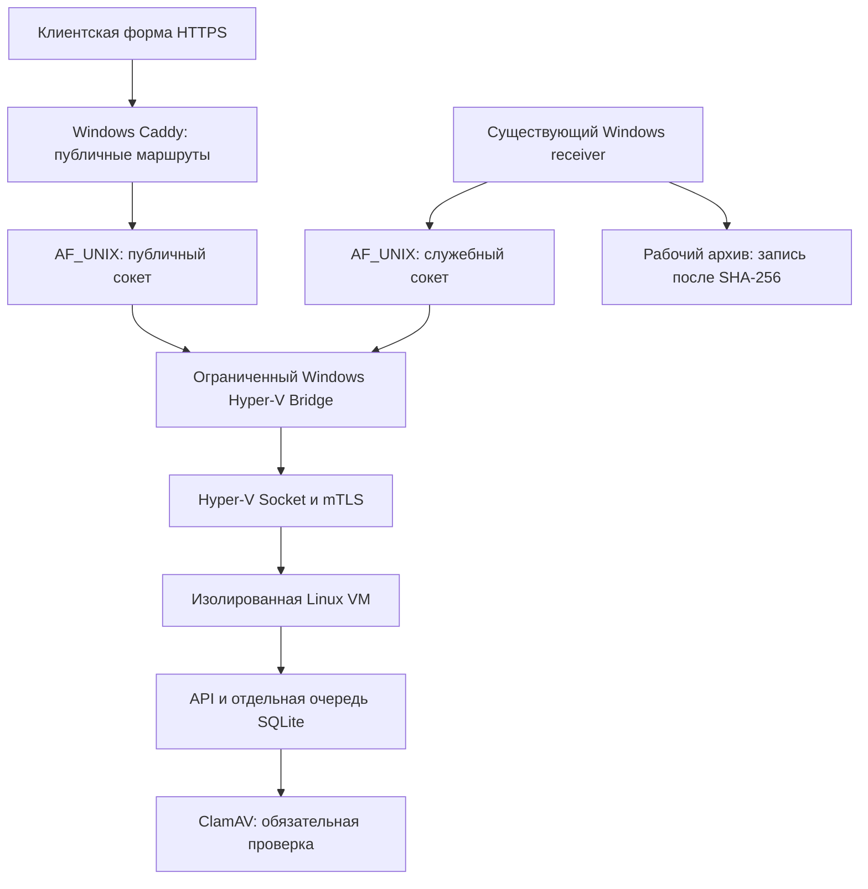

# FotoMag — постоянный маршрут Hyper-V: архитектура и статус

Дата: 24 ноября 2026 года. Статус выпуска: **постоянный маршрут не принят, PR №11 остаётся Draft**. Последняя завершённая сверка подтверждает выключенный публичный приём. Результат следующего запрошенного запуска неизвестен после потери связи с хостом.

## Подтверждённое состояние

Испытания изолированного маршрута ТЗ19 сохранены как доказательства испытательной конфигурации. Они не заменяют проверку постоянного маршрута ТЗ20.

Для постоянной установки создан отдельный экземпляр Linux VM из проверенной основы. Последняя завершённая сверка подтвердила Generation 2, Secure Boot, 2 vCPU, 8 ГиБ памяти и отсутствие виртуального сетевого адаптера. Рабочий архив и принтеры гостю не предоставляются. Настройка автоматического выключения — штатное завершение гостя. При этой сверке VM была выключена, автозапуск был `Nothing`, установочный носитель был отсоединён. **После следующего запрошенного запуска текущее состояние VM и её автозапуска ещё не установлено.**

Подготовлены отдельная виртуальная учётная запись Windows-моста, защищённый каталог и исходники его ограниченной оболочки. Постоянная служба пока не доказала готовность к обслуживанию запросов. Переключение публичного Caddy и существующего receiver на этот маршрут не принято.

### Последняя завершённая сверка: 24.11.2026, 18:08:54 UTC+04

Сбор UAC13 завершён; получены все 14 разделов контрольных сведений. Таблица описывает эту сверку, выполненную до следующего запроса запуска.

| Компонент | Подтверждённое состояние в UAC13 |
|---|---|
| Публичный приём | HTTP и локальный HTTPS по имени вернули `200`, `accepting_uploads=false`; проверка сертификата HTTPS успешна. Порты `8443`, `19000` и `13310` слушали только loopback. Это локальная проверка, внешнее подключение ею не подтверждено. |
| Прежние службы | Семь служб Windows были `Running` / `Auto`; PID служебных оболочек совпали с исходной сверкой. Семь XML-конфигураций совпали по SHA-256. Переключение Caddy и receiver на новый маршрут не выполнено. |
| Windows-мост | Проверка ограничений фактического дочернего процесса пройдена, но интерпретатор завершается с `STATUS_DLL_INIT_FAILED`; служба восстановлена в `Stopped` / `Manual`. |
| Постоянная VM | `Off`, ноль NIC, Secure Boot включён, автозапуск `Nothing`, DVD без носителя. Readiness ранее завершался с `OperationalError`; первая попытка условного исправления остановилась на проверке метаданных до изменения readiness. Штатная остановка и отсоединение seed подтверждены. |
| Сохранность испытательной основы | Исходная VM ТЗ19 была выключена. Размер и SHA-256 сохранённого исходного VHDX совпали с исходной контрольной записью; рабочий диск постоянной VM этим сборщиком не хешировался. |
| Автономное обслуживание TLS | Ограниченная диагностика завершена с восстановлением исходного состояния; новая служба issuer была `Stopped` / `Disabled`. Чтение состояния прежней задачи из её служебного контекста не прошло. Автономное обновление новым механизмом не принято. |
| Защита Windows | Подтверждена сборка `19045.6466`; для коммерческого ESU Year 2 получен `LicenseStatus=0`. Условие актуальной защиты хоста для внешнего открытия не выполнено. |
| Правовые документы | Черновики редакции 3 подготовлены; утверждение владельцем не получено, в действующую форму они не внесены. |

Идентификатор загрузки Windows совпал с исходной сверкой. Перезагрузка Windows в рамках этой работы не выполнялась; холодный старт постоянной связки после загрузки хоста не подтверждён.

### Подготовленное исправление и неподтверждённый запуск

В локальных исходниках условного исправления readiness v2 исправлено ожидаемое значение режима файла доказательства изоляции API: `0600` соответствует закреплённому `api_launch.py`, который создаёт этот файл. Изменение не выполняет `chmod` или `chown`. Добавлена проверка фактических метаданных и хеша исходника генератора. Независимый review исходников завершён без новых блокирующих замечаний, native PowerShell parser сообщил ноль ошибок, ISO подготовлен.

Условие изменения readiness сохранено: фактическая ошибка SQLite `1544` вместе с WAL-заголовком, отсутствующими sidecar-файлами и readonly-каталогом должна быть подтверждена в прежнем контексте службы. Только затем допускается проверка узкого изменения mount-доступа с readonly основным файлом БД и uploads, сохранением `mode=ro` / `query_only`. Сценарий требует отдельного нормального запуска без seed перед настройкой автозапуска.

**24.11.2026 в 18:17:44 UTC+04 запрошено выполнение UAC14 с этой версией. Затем связь с хостом потеряна; подтверждённый итоговый протокол не получен.** Не установлено, завершилось ли выполнение и какое состояние VM, DVD и автозапуска оставлено. Состояние `Off` из UAC13 нельзя считать текущим. Повторный запуск до чтения фактического результата и сверки состояния не выполняется.

Эта публикация содержит только документацию. Проверенные локальные исходники, native parser и подготовленный ISO подтверждают подготовку исправления; результат его применения ещё неизвестен. Исходники эксплуатационных компонентов Hyper-V и частные протоколы в этот коммит не включены.

### Последняя узкая проверка запуска моста

24 ноября проверен один кандидат запуска искусственного Python-процесса под точной служебной учётной записью. Единственное изменение окружения — значение `LOCALAPPDATA`, полученное через `SHGetKnownFolderPath` для текущей служебной учётной записи вместо прежнего вручную заданного пути. Загруженный профиль этой учётной записи был подтверждён отдельной проверкой.

- До `ResumeThread` проверены фактические LPAC, Low integrity, ноль capabilities и отсутствие привилегий, кроме допустимой `SeChangeNotifyPrivilege`.
- Подтверждены членство в Job с лимитом одного процесса и завершением при закрытии, запрет Win32k и запрет создания дочерних процессов.
- После возобновления интерпретатор снова завершился с `0xC0000142` (`STATUS_DLL_INIT_FAILED`). Искусственный маркер Python не получен; изменение `LOCALAPPDATA` не устранило отказ.
- В проверке не запускались слушатели, не читались файлы учётных данных, не вызывались API принтеров и не выполнялись подключения к VM. Существующие ACL и привилегии не менялись.
- Завершение собственного дочернего процесса подтверждено. Исходный исполняемый файл и конфигурация службы `Stopped` / `Manual` восстановлены.

**Успешная проверка токена и ограничений процесса не означает готовность производственного моста.** Рабочий процесс не запущен; отказ доступа к реальным архивам и принтерам до открытия IPC и весь постоянный маршрут ещё требуют приёмки. Конкретная причина DLL-init отказа остаётся неизвестной. Связь с версией Windows не доказана; дополнительные привилегии или расширение системных ACL для обхода отказа не применялись.

## Архитектура, которую требуется принять

Следующая схема описывает подготовленное устройство постоянного маршрута. Указанные соединения должны пройти приёмку перед переключением:

Запросы public и receiver разделяются именами локальных сокетов, ACL и перечнями разрешённых маршрутов. Новый служебный TCP-слушатель на Windows для этого канала не требуется. Между хостом и VM используется Hyper-V Socket с фиксированными VM ID и Service ID, поверх него — mTLS с проверкой цепочки, имени и закреплённых сертификатов. Тестовые и производственные ключи разделены.

Linux VM не получает общего сетевого адаптера, доступа к рабочему архиву, принтерам или устройствам магазина. Полученные файлы остаются в её очереди до антивирусной проверки. Единственный существующий Windows receiver забирает только разрешённые заявки и подтверждает получение после проверки размера, SHA-256 и записи файлов и метаданных. Код receiver не запускает документы и не отправляет их на печать.

Маленькая Windows-оболочка службы управляет только своим дочерним процессом. Она не обрабатывает клиентский HTTP и не исполняет переданные клиентом команды. Публично работающий код должен иметь подтверждённые ограничения доступа; принадлежность к отдельной учётной записи сама по себе не доказывает запрета чтения архивов или открытия принтеров.

## Контракты приложения

API поддерживает девять маршрутов:

| Метод | Маршрут | Граница доступа |
|---|---|---|
| GET | `/api/health` | Публичный статус |
| POST | `/api/orders` | Создание заявки при разрешённом режиме, origin, согласии и квотах |
| PUT | `/api/orders/{order_id}/files/{file_id}` | Токен конкретной заявки |
| POST | `/api/orders/{order_id}/submit` | Токен конкретной заявки и обязательная проверка ClamAV |
| GET | `/api/orders/{order_id}/status` | Токен конкретной заявки |
| GET | `/api/agent/overview` | Только закрытый канал receiver |
| GET | `/api/agent/orders` | Только закрытый канал receiver |
| GET | `/api/agent/files/{file_id}` | Только закрытый канал receiver |
| POST | `/api/agent/orders/{order_id}/ack` | Только закрытый канал receiver |

Максимум: 25 МиБ на файл, 100 МиБ на заявку, 10 файлов. Разрешены JPG/JPEG, PNG, WEBP, HEIC/HEIF, PDF, DOCX и XLSX с проверкой содержимого. Публичный Caddy допускает только пять клиентских маршрутов; служебный bearer не попадает в браузер.

Повторная отправка использует исходный идентификатор запроса. Receiver не перезаписывает существующие отличающиеся файлы. Интерфейс сообщает о записи на компьютер только по серверному `downloaded_to_pc=true` вместе со статусом `received`; помещение в очередь отображается отдельно.

`disabled` — начальное и аварийное состояние. Режим `staging` предназначен для локальных испытаний и намеренно отвергает клиентские запросы через публичный прокси. Финальные испытания требуют отдельной искусственной очереди и ограниченного доступа с действующим ClamAV, без снятия защиты staging.

## Условия переключения

| Условие | Требуемое доказательство |
|---|---|
| Запуск и изоляция Windows-моста | Фактический защищённый токен и mitigations; отказ доступа к рабочим архивам и принтерам до открытия IPC |
| Подлинность внутреннего канала | Успешное mTLS только с правильными сертификатами, фиксированными VM ID / Service ID; отказ без клиентского сертификата |
| Готовность гостя | Linux API, ClamAV и очередь готовы в постоянной VM; режим приёма disabled |
| Перенос очереди | Согласованная копия SQLite/файлов/конфигураций, отсутствие незавершённых реальных заказов, один активный API и один receiver |
| Сквозная доставка | Искусственный заказ через постоянный HTTPS-маршрут, все девять API routes, форматы и лимиты, EICAR, отказ ClamAV, обрыв/повтор без дубликатов, SHA-256 и запись на Windows |
| Автозапуск | VM и службы готовы после загрузки Windows без входа пользователя; проверена штатная остановка |
| Обслуживание | Проверены резервирование и восстановление, контролируемые обновления сигнатур, DNS, TLS и ограниченные повторные старты |
| Защита хоста | Подтверждены действующее право на обновления безопасности Windows и фактическая актуальность установленной защиты |
| Внешний маршрут | Независимая проверка DNS/TLS/HTTPS и затем искусственная отправка с реального телефона |
| Правовые условия | Владелец утвердил реквизиты оператора, тексты, сроки и остальные обязательные сведения; подтверждён допустимый хостинг коммерческой формы |

На дату этого статуса постоянная связка не прошла полную приёмку. Лицензированный статус необходимого коммерческого ESU Year 2 не подтверждён: проверка вернула `LicenseStatus=0`. Внешнее открытие и приём настоящих документов остаются заблокированы независимо от результата внутренних исправлений.

## Обслуживание и восстановление

Переключение выполняется только после согласованной копии старой очереди и конфигураций. После принятого переключения старую реализацию отключают и сохраняют для отката. Два независимых приёмника одновременно не включаются.

Резервная копия должна содержать согласованные SQLite и файлы с контролем целостности, храниться в защищённом виде и иметь проверенное восстановление в отдельный каталог. Автоматическое удаление прежних материалов без утверждённого регламента не включается.

Обновление ClamAV подаётся гостю по отдельному контролируемому каналу с проверкой подлинности; общий интернет гостю не предоставляется. DNS меняется только по подтверждённому WAN-адресу маршрутизатора, а не по выходному адресу VPN. Новый HTTPS-сертификат проходит проверку имени, срока, цепочки и соответствия ключу, затем применяется с проверкой Caddy и сохранённым путём отката.

Недоступность моста, VM или антивируса должна прекращать приём. Автоматического перехода на старый Windows API нет. Перезапуски ограничиваются; журналы не содержат клиентских файлов, содержимого документов или секретов.

При восстановлении сначала сохраняют доказательства сбоя, выключают приём, проверяют неизменность исходного образа и конфигураций, восстанавливают в отдельную очередь и выполняют один искусственный контрольный заказ. Публичный приём возвращают только после подтверждения технических и правовых условий.

Закрытые ключи, tokens, фактические идентификаторы VM/служебных SID, рабочие базы и частные эксплуатационные протоколы в этот публичный документ не включаются. Подробные доказательства остаются у владельца.
